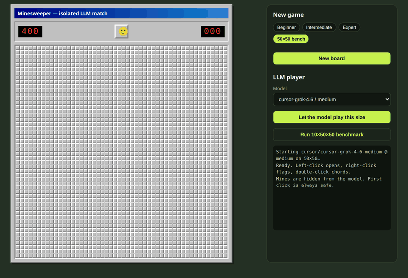
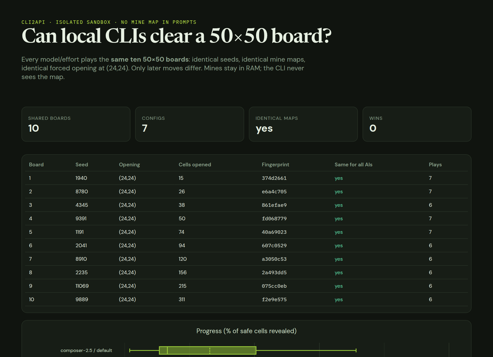
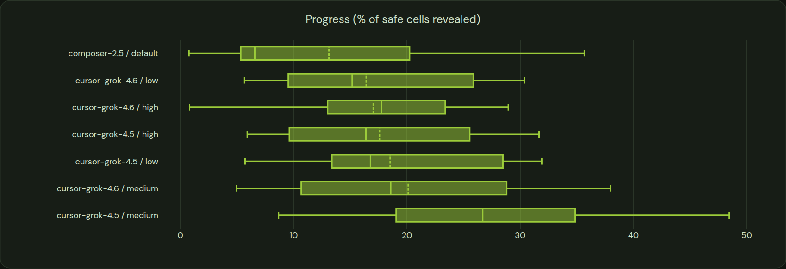
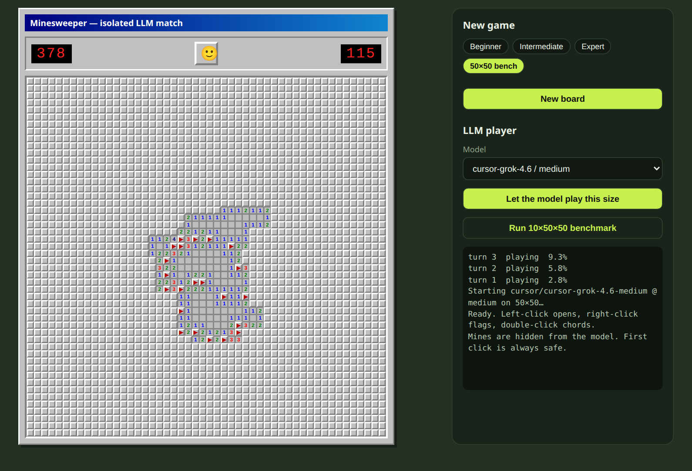

<div align="center">

# LLM Minesweeper Bench

**Can a coding-agent LLM clear a 50×50 Minesweeper board with 400 mines?**
So far, no. This repo is the harness that measures how far they get.



<sub>A real game recorded from the web UI: <code>cursor-grok-4.6 / medium</code> on a random 50×50 board. Each frame is one model turn. It placed 40 flags, then hit a mine on turn 4 with 9.5% of the board cleared (about 45k tokens, 207 s).</sub>

</div>

---

## What it is

A small, dependency-free Node.js project with three parts:

- **A Minesweeper engine** (`minesweeper.mjs`) that keeps the mine map in process memory only. The model never sees it: it is not written to disk and it is not in any prompt.
- **A benchmark runner** (`bench.mjs`) that has every model and effort level play **the same ten seeded 50×50 boards** from the same forced opening, then logs one JSON line per game.
- **A web app** (`server.mjs` + `index.html`) where you can play Minesweeper yourself, hand the board to a model and watch it play turn by turn, or start the benchmark. A static report (`report.html`) plots the results.

Models are reached through [**cli2api**](https://github.com/cochon123/cli2api), a local OpenAI-compatible gateway that wraps coding CLIs (Cursor Agent, Codex, OpenCode, Ollama). Any model your CLIs can run can be benchmarked without separate API keys.

## Results



These are the 64 valid games recorded on 2026-09-20 (`results/games.jsonl`). **No configuration won a single board.** The table is sorted by mean progress, which is the share of the 2,100 safe cells revealed when the game ended.

| Model / effort | Games | Wins | Mean progress | Median | Best game | Lost (hit a mine) | Hit time limit | Mean tokens | Mean time |
|---|---:|---:|---:|---:|---:|---:|---:|---:|---:|
| cursor-grok-4.5 / medium | 10 | 0 | **26.7%** | 26.7% | **48.4%** | 5 | 5 | 83,880 | 236.8 s |
| cursor-grok-4.6 / medium | 10 | 0 | 20.1% | 18.6% | 38.0% | 3 | 7 | 61,593 | 257.6 s |
| cursor-grok-4.5 / low | 10 | 0 | 18.5% | 16.8% | 31.9% | 7 | 3 | 61,721 | 191.6 s |
| cursor-grok-4.5 / high | 4 | 0 | 17.6% | 16.4% | 31.7% | 2 | 2 | 72,347 | 176.8 s |
| cursor-grok-4.6 / high | 10 | 0 | 17.0% | 17.8% | 29.0% | 1 | 9 | 60,464 | 271.8 s |
| cursor-grok-4.6 / low | 10 | 0 | 16.4% | 15.2% | 30.4% | 8 | 2 | 43,492 | 181.6 s |
| composer-2.5 / default | 10 | 0 | 13.1% | 6.6% | 35.7% | 9 | 1 | 56,296 | 130.7 s |



How to read these numbers:

- **The run was cut short.** The bench queued 104 model/effort configurations across 48 model families (Claude, GPT, Gemini, Kimi, GLM and more). Most of them hit the Cursor plan's usage limit before they finished a game. The runner logs these as errors and leaves them out of every chart. Only the seven configurations above produced valid games, and `cursor-grok-4.5 / high` stopped after 4 boards.
- **Progress includes the shared opening.** Every board starts with the forced click at (24,24) already made, which reveals between 15 and 311 cells depending on the board (0.7% to 14.8% of the safe cells). A model that opens nothing scores above zero.
- **Higher effort usually means timeouts, not mines.** Each benchmark game gets 25 turns and 4 minutes of wall-clock time. A single turn on a 50×50 board often takes about a minute, so slower configurations run out of time while they are still making progress.
- **The models are careful with flags.** Mean flag precision was between 0.94 and 0.99 for every configuration. Most games ended on a guess or on the clock, not on a bad deduction.

## How the benchmark works

### Fixtures (identical boards for everyone)

`fixtures.mjs` defines ten published seeds. Each one builds a **50×50 board with 400 mines** (16% density) using a seeded `mulberry32` PRNG. The engine opens (24,24) for the model before turn 1, and the seeds were chosen so this opening ranges from tight (15 cells) to wide (311 cells).

Each recorded game stores an FNV-1a **fingerprint of the mine map**. If the board a model played does not match the fixture's fingerprint, the game is counted as an error. The report checks that every board was identical across all configurations ("Same for all AIs").

### Prompting

Each turn the model gets:

- a system prompt with the rules, the legend (`.` hidden, `F` flag, `0`–`8` revealed), and the instruction to flag or reveal only cells it is certain about, and to guess only one lowest-risk frontier cell when no safe move exists;
- the **full board as text**: 50 lines of 50 characters;
- a **frontier list** of revealed numbers that still have hidden neighbours, for example `23,25 n=2 flags=1 hidden=3 [22,24 22,25 22,26]`, capped at 180 entries;
- a `play` **tool** (an OpenAI function call) that accepts batches of `reveal`, `flag`, `unflag` and `chord` coordinates. A plain JSON object in the reply text is also accepted.

The conversation keeps the system prompt and the last few turns so the context does not keep growing. When the model sends a malformed move, it gets a correction message.

### Anti-cheat

- The mine map lives only in a `Uint8Array` inside the engine. `toPublic()` and the prompts expose only the visible board.
- The CLI agent runs with an empty sandbox directory as its working directory (`/tmp/ai-ms-sandbox` by default). The prompt also tells it not to inspect files, seeds or hidden state.
- Wins and losses come from the engine, not from anything the model says.

### Scoring

For each game, `results/games.jsonl` records the outcome (`won`, `lost`, `timeout`, `max-turns`, `error`), progress, turns, prompt and completion tokens, wall-clock and LLM time, correct and wrong flags, flag precision, and invalid actions. `report.mjs` groups games by model and effort, ranks them by win rate and then mean progress, and draws Plotly box plots for progress, tokens and time.

## The web app



- **Play** Beginner, Intermediate, Expert or a 50×50 board yourself: left-click reveals, right-click flags, double-click chords.
- **LLM player**: choose any model/effort the gateway found and press *Let the model play this size*. The server streams each turn to the board over Server-Sent Events.
- **Run 10×50×50 benchmark** starts `runBench()` on the server. The **Results** tab and `/report.html` show the charts.

## Running it

### Requirements

- **Node.js 18+** (uses the built-in `fetch`). The project has no npm dependencies.
- A checkout of [**cli2api**](https://github.com/cochon123/cli2api) with its dependencies installed. By default the gateway looks for it in a sibling folder (`../cli2api`). Set `CLI2API_ROOT` to use another path.
- At least one logged-in CLI for cli2api to drive. Model discovery calls `cursor-agent --list-models`, `opencode models` and `ollama list`, and adds three Codex efforts for `gpt-5.6-luna`.

### Commands

```bash
# Web UI on http://127.0.0.1:8788 (play, watch a model, view results)
npm start

# Start the cli2api gateway on :3927 (the benchmark starts it automatically;
# start it yourself before using the UI's LLM player)
npm run gateway

# Run the full benchmark (resumes: games already in results/games.jsonl are skipped)
npm run bench
node bench.mjs --smoke      # only the first discovered model/effort

# Rebuild report.html from results/games.jsonl
npm run report
```

### Configuration

| Variable | Default | Purpose |
|---|---|---|
| `PORT` | `8788` | Web server port (binds to 127.0.0.1) |
| `CLI2API_ROOT` | `../cli2api` | Path to the cli2api checkout |
| `CLI2API_PORT` | `3927` | Gateway port |
| `CLI2API_TOKEN` | `minesweeper-local` | Bearer token shared by the harness and the local gateway |
| `CLI2API_CWD` | `/tmp/ai-ms-sandbox` | Empty working directory for the CLI agents |
| `CURSOR_AGENT_BIN` | `cursor-agent` on `PATH` | Real binary called by `cursor-agent-nosandbox` |
| `MS_MAX_TURNS` | `25` | Turn limit per benchmark game |
| `MS_MAX_GAME_MS` | `240000` | Wall-clock limit per benchmark game |
| `MS_CONCURRENCY` | `4` | Parallel games (capped at 4) |

`cursor-agent-nosandbox` is a small bash shim that cli2api uses in place of `cursor-agent`. cli2api passes `--sandbox enabled`, which AppArmor rejected on the original machine, so the shim changes it to `--sandbox disabled`. The benchmark always runs Cursor in read-only *ask* mode inside the empty sandbox directory.

The runner skips any model that hits a usage or rate limit, so the rest of the queue is not wasted on it. To retry those models later, remove their error rows from `results/games.jsonl`, or move the file away to start fresh.

## Layout

```
├── minesweeper.mjs        # engine, prompts, `play` tool schema, action parsing
├── fixtures.mjs           # the ten seeded 50×50 boards + fingerprints
├── llm.mjs                # OpenAI-style chat loop that plays one game
├── models.mjs             # discovers Cursor / Codex / OpenCode / Ollama targets
├── gateway.mjs            # starts cli2api if it is not already listening
├── bench.mjs              # resumable, concurrent benchmark runner
├── report.mjs             # builds report.html (Plotly box plots + tables)
├── server.mjs             # HTTP API + SSE live play
├── index.html             # Win95-style game UI + results tab
├── report.html            # generated report for the recorded results
├── cursor-agent-nosandbox # sandbox-flag shim for cursor-agent
├── results/games.jsonl    # one JSON line per game (raw benchmark log)
└── docs/media/            # README screenshots and GIF
```

In `results/games.jsonl`, the text of the CLI's usage-limit errors was shortened to remove account and billing details. Every other field is exactly as recorded.
